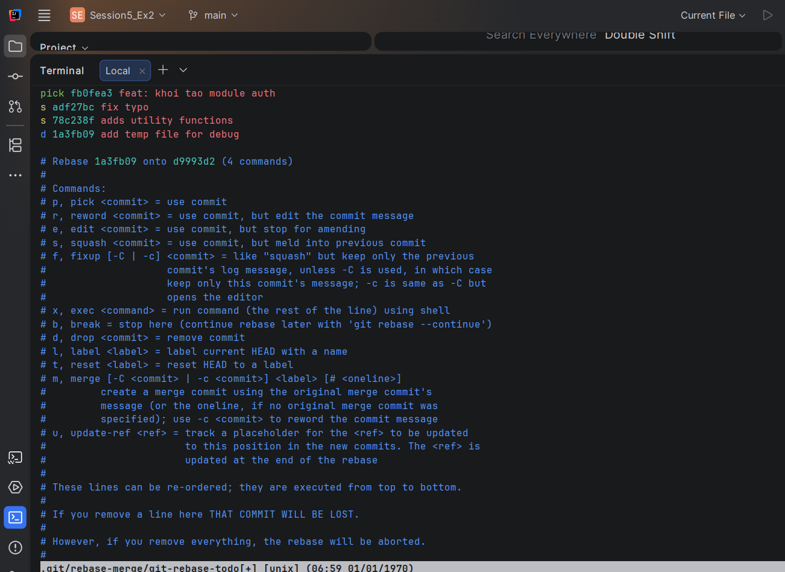

# Báo cáo Bài 2: Tái cấu trúc lịch sử commit bằng Interactive Rebase

**Đường dẫn thư mục:** `homework/session_05/ex2/`

---

## 1. Bối cảnh
Trước khi đẩy mã nguồn lên remote repository, nhánh tính năng chứa nhiều commit thử nghiệm vụn vặt với thông điệp chưa rõ ràng (`fix typo`, `adds utility functions`), đồng thời chứa file rác thử nghiệm (`temp.txt`).

---

## 2. Các bước thực hiện

### Bước 1: Khởi tạo 4 commit ban đầu
Tiến hành khởi tạo môi trường và tạo 4 commit lần lượt:
1. `fb0fea3` - `feat: khoi tao module auth` (Tạo file `auth.js`)
2. `adf27bc` - `fix typo` (Sửa file `auth.js`)
3. `78c238f` - `adds utility functions` (Sửa file `auth.js`)
4. `1a3fb09` - `add temp file for debug` (Tạo file rác `temp.txt`)

---

### Bước 2: Thực hiện Interactive Rebase
Chạy lệnh rebase tương tác:
```bash
git rebase -i --root
```

Cấu hình các thao tác trong trình soạn thảo Vim:
```text
pick fb0fea3 feat: khoi tao module auth
s adf27bc fix typo
s 78c238f adds utility functions
d 1a3fb09 add temp file for debug
```

**Chi tiết thao tác:**
- `pick`: Giữ lại commit khởi tạo tính năng gốc.
- `squash` (viết tắt là `s`): Gộp commit 2 (`adf27bc`) và commit 3 (`78c238f`) vào commit 1.
- `drop` (viết tắt là `d`): Xóa bỏ hoàn toàn commit 4 (`1a3fb09`) chứa file rác `temp.txt`.

---

### Bước 3: Đổi tên thông điệp commit (Reword)
Sau khi lưu cấu hình rebase (`:wq`), trình soạn thảo mở ra giao diện chỉnh sửa thông điệp gộp. Tiến hành cập nhật lại thành:

```text
feat: hoan thien module authentication
```

---

## 3. Kết quả thu được

### 1. Kiểm tra lịch sử commit
Chạy lệnh `git log --oneline`:
```text
4a8e2b1 (HEAD -> main) feat: hoan thien module authentication
```

### 2. Kiểm tra danh sách file trong working tree
- File `auth.js` tồn tại với đầy đủ mã nguồn đã được tổng hợp.
- File rác `temp.txt` đã bị xóa hoàn toàn khỏi repository.

---

## 4. Kết luận
Lịch sử commit đã được tái cấu trúc thành công: gộp 3 commit nhỏ thành 1 commit duy nhất chuẩn mực, cập nhật thông điệp rõ ràng và loại bỏ hoàn toàn commit rác đúng theo yêu cầu đề bài.

